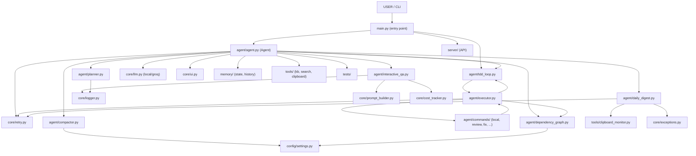

# Architecture

This document captures the high-level architecture of the Autonomous AI Agent,
including the component data/call flow and the real import dependency graph.

## Component Architecture (Mermaid)

## Import Dependency Graph

